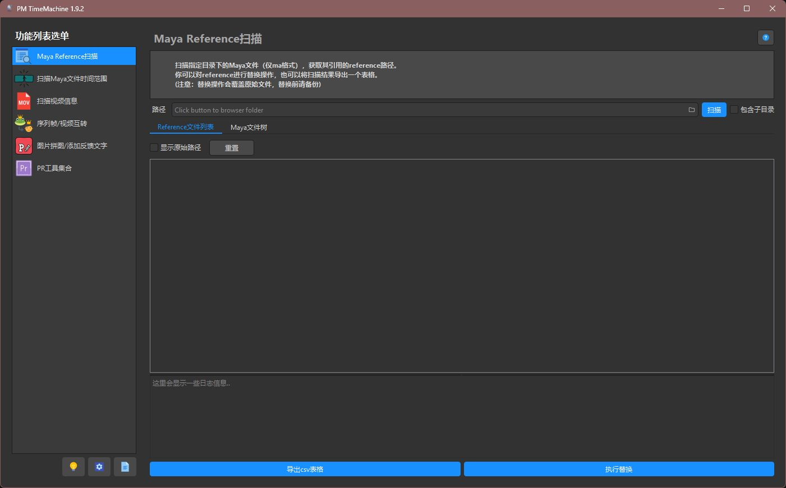

# PMTM · PM TimeMachine

PMTM 是面向视效行业制片的桌面工具集，用于扫描素材、整理信息和处理重复操作。

> 每次点击按钮，就像时间机器一样“快进”到任务完成。



*截图来自 Windows 编译版 1.9.2，使用深色主题。*

## 功能

- **Maya Reference 扫描**：扫描 `.ma` 文件中的引用路径，导出结果并批量替换引用。
- **Maya 时间范围扫描**：读取 `.ma` 文件的开始帧和结束帧，导出表格。
- **视频信息扫描**：读取视频帧数、帧率、分辨率等信息，支持缩略图、表格导出及音频提取。
- **序列帧 / 视频互转**：扫描素材，设置输出格式、帧率和序列起始帧后批量转换。
- **图片拼图 / 添加反馈文字**：为图片添加文字，分别输出或拼接成整张图片。
- **Premiere Pro 工具**：批量修改所选 clips 的名称、分别导出 clips；需安装 Pymiere Link。

Maya Reference 替换会覆盖原始文件，操作前请备份。

## 下载安装（Windows）

从[下载页面](https://lingyunfx.com/pmtm-download/)获取对应版本的安装包，或使用本项目自行构建的 `PMTimeMachine-<版本号>-Setup.exe`。

1. 运行 Setup 安装包，按向导选择安装目录和快捷方式。
2. 安装完成后，从开始菜单或桌面快捷方式打开 **PM TimeMachine**。
3. 需要视频或图片处理功能时，在窗口左下角的齿轮按钮中配置外部工具路径。

安装包包含 Python 运行时、Qt 和应用资源，使用者无需另装 Python 或 uv。
默认仅为当前用户安装，无需管理员权限，默认目录为 `%LOCALAPPDATA%\Programs\PM TimeMachine`。
可在 Windows“设置 → 应用”中找到 **PM TimeMachine** 并卸载，也可运行安装目录内的 `uninstall.exe`。
请使用独立的应用安装目录，不要把项目素材或其他个人文件放入其中。

### 外部工具配置

以下工具不包含在安装包内，按需安装后，在 PMTM 设置中填写对应可执行文件的完整路径：

| 设置项 | 可执行文件 | 用途 |
| --- | --- | --- |
| ffmpeg 路径 | `ffmpeg.exe` | 视频与序列帧转换、音频提取等 |
| ffprobe 路径 | `ffprobe.exe` | 视频信息读取 |
| magick 路径 | `magick.exe` | 图片处理相关功能 |

Premiere Pro 工具还需要本机安装 Premiere Pro 和 Pymiere Link。
详细操作见[使用文档](https://lingyunfx.com/pmtm-doc/)，也可点击各工具右上角的问号查看帮助。

## 开发环境

项目使用 **Python 3.10**、**PySide2 5.15.2.1** 和 [uv](https://docs.astral.sh/uv/) 管理依赖。
以下命令在 Windows PowerShell 中执行。

安装 uv（已安装可跳过）：

```powershell
powershell -ExecutionPolicy ByPass -c "irm https://astral.sh/uv/install.ps1 | iex"
```

进入项目根目录，同步锁定的依赖并启动：

```powershell
uv sync --locked
uv run pmtm
```

uv 会创建 `.venv` 并安装所需依赖；缺少兼容的 Python 时会尝试自动下载。
日常开发直接执行 `uv run pmtm`，不需要手动激活虚拟环境。

## 构建 Windows 安装包

使用 **Nuitka 4.3.3 或更新版本**将 Python 代码编译为独立程序目录，再通过内置的 NSIS 支持生成安装包。
在 Windows 上进入项目根目录执行：

```powershell
uv sync --locked --all-groups
uv run python -m nuitka --mingw64 main.py
```

首次构建会按提示下载 Nuitka 支持的 MinGW64 和 NSIS，请保持网络连接。
若已安装 Visual Studio 2022 Build Tools 的 C++ 工具链，可改用：

```powershell
uv run python -m nuitka --msvc=latest main.py
```

构建参数保存在 `main.py` 顶部的 `nuitka-project` 注释中，包括 PySide2 插件、QtSvg、
应用图标、项目资源、dayu_widgets 静态资源，以及安装包的名称、版本和快捷方式。
程序以图形界面运行，不额外弹出控制台窗口。

### 构建产物

| 路径 | 说明 |
| --- | --- |
| `dist/PMTimeMachine-<版本号>-Setup.exe` | 对外分发的安装包，例如 `PMTimeMachine-1.9.2-Setup.exe` |
| `dist/main.dist/` | 编译后的完整程序目录，供安装器打包；不能只复制其中的 exe |
| `dist/main.build/` | 编译中间文件，无需分发 |

如果 `dist/PMTimeMachine.exe` 仍存在，它是之前单文件模式的旧产物，不是当前安装包。
当前采用目录模式：安装时释放文件，之后启动无需每次解压整套程序。

Nuitka 可能提升 Python 逻辑的执行速度，但不会直接加速 FFmpeg 等外部程序或磁盘读写；实际效果以测量为准。

### 发布前检查

安装、启动及卸载流程已在本机验证。发布前仍应在目标 Windows 环境中检查：

- 安装后能从快捷方式启动，图标、主题与资源显示正常。
- 按钮、信号槽及各工具的实际操作正常，外部程序路径配置有效。
- 卸载入口正常，分发的是新生成的 Setup 安装包。

普通版 PySide2 5.15.2.1 对编译后的事件回调仅有部分支持，启动成功不代表所有交互均已验证。
如遇相关问题，可评估迁移到 PySide6，或使用 Nuitka Commercial 提供的修补版 PySide2。
参见 [Nuitka 的 PySide2 支持说明](https://nuitka.net/info/pyside2.html)。

## 开发维护

### 版本号

版本号只维护在 `pmtm/constant.py` 的 `VERSION` 中。Python 包元数据由 hatchling 动态读取，
Nuitka 的程序版本和安装包文件名也从同一处读取。发版时修改该值，再同步环境并重新构建。

### 资源与截图

应用资源位于 `resource/`。`pmtm.run()` 启动时会切换到资源所在的根目录：源码运行时是项目根目录，
安装版运行时是安装目录，以兼容代码中的 `./resource/xxx` 引用。
开发和构建都需要这个目录，不要删除。

已移除与 dayu_widgets 重复的 112 个资源文件，库内图标和主题直接使用依赖包中的 `static` 资源；
Nuitka 通过 `--include-package-data=dayu_widgets` 收集它们。`resource/` 仅保留 19 个项目独有资源。
未使用的本地 `main.qss` 已删除，明暗主题统一加载 dayu_widgets 自带的样式。

README 截图保存在 `docs/images/`，使用仓库内的相对路径引用，不依赖外部图床。
更新界面后，请重新截取实际运行的窗口并同步替换图片。

### 第三方库补丁

`dayu_widgets` 和 `dayu_path` 的修正集中在 `pmtm/compat.py`，由 `pmtm.run()` 启动时应用。
不要直接修改 `.venv` 内的第三方源码，避免污染 uv 缓存，使环境可以随时重建。

补丁包括：

- 为 `dayu_widgets.utils.icon_formatter` 注册 `QPixmap` 分支，让表格显示图片缩略图。
- 修正 `DayuPath.scan`，使 `regex_pattern`、`ext_filters` 和 `function_filter` 多个过滤条件叠加生效。
- 将生成器内部的 `raise StopIteration` 改为 `return`，避免 Python 3.7+ 的 `RuntimeError`。

`scan` 的替换实现基于 dayu-path 0.5.2，升级依赖时需重新与上游比对。
